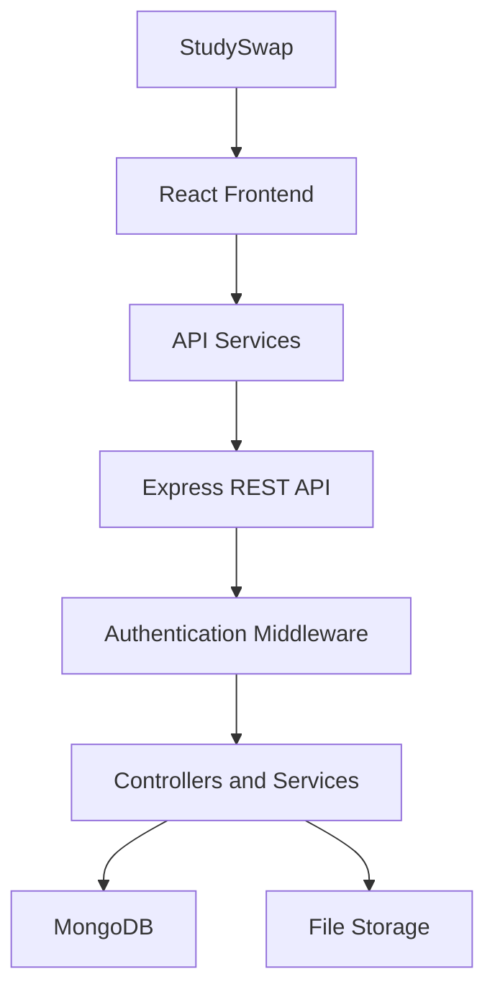
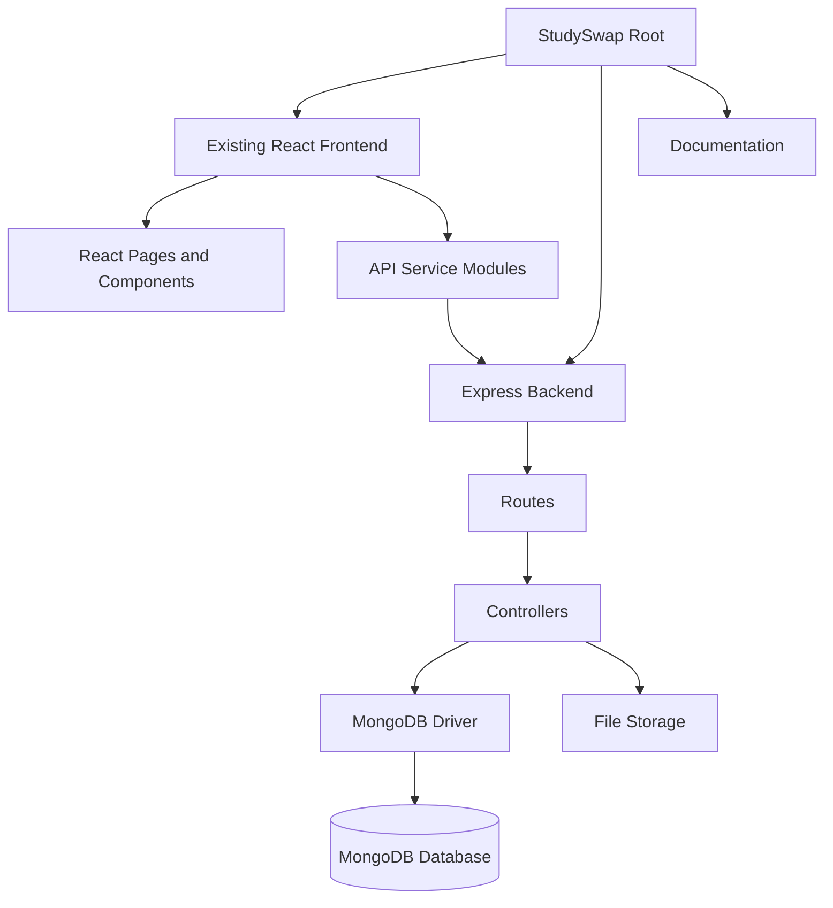
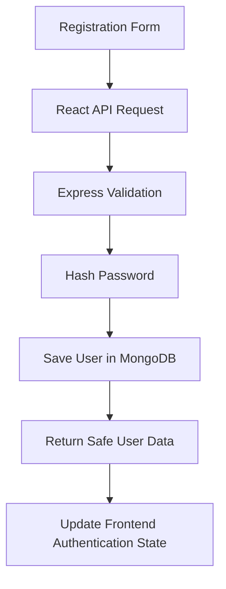
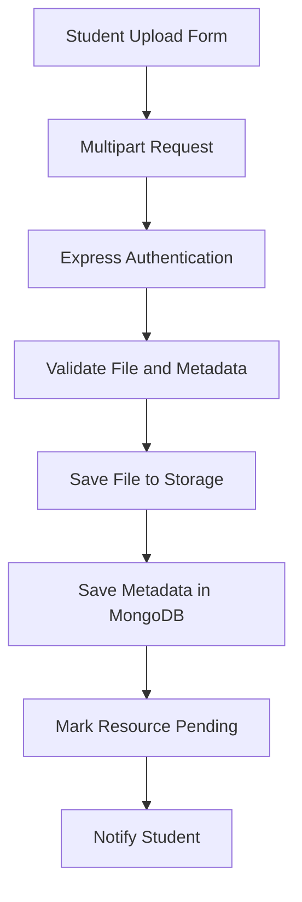
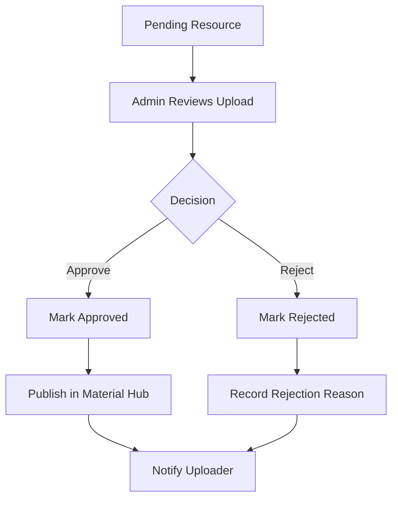
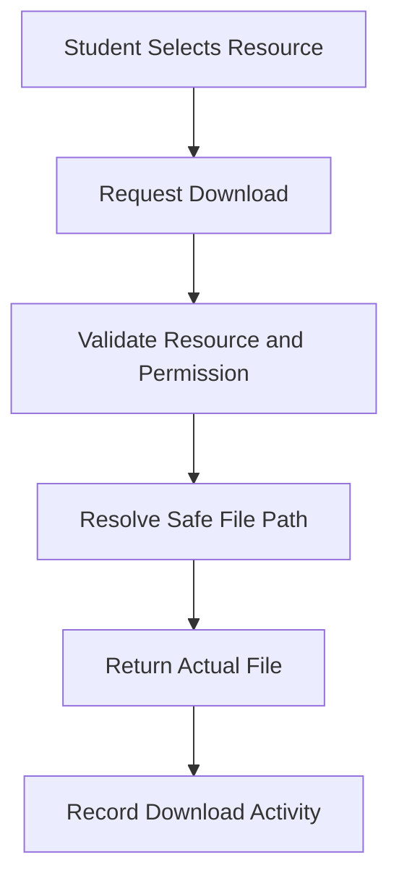

# StudySwap — System Architecture

> **Find. Share. Learn. Together.**
> Full-Stack Student Academic Resource Sharing and Discovery Platform

---

## 1. Overall System Architecture

---

## 2. Project File Flow

---

## 3. Student Registration Flow

---

## 4. Academic Resource Upload Flow

---

## 5. Administrative Moderation Flow

---

## 6. Secure Resource Download Flow

---

## Architectural Principles & Decisions

| Decision | Implementation | Rationale |
|---|---|---|
| **Frontend Root** | `studyswap-frontend-claude/` | Preserves the complete Claude-generated Red Noir interface without regression. |
| **Authentication** | JWT stored in `httpOnly` cookie (`token`) | Prevents token theft via XSS; credentials sent via `credentials: 'include'`. |
| **Database Access** | Official MongoDB Node.js Driver (no Mongoose) | Direct, performant, standards-compliant query functions conforming to FSD exam syllabus. |
| **Single Material Hub** | `GET /api/resources` with query filters | Exactly one hub where branches, semesters, and types are filters within the same view. |
| **File Storage** | Safe local disk storage in `server/uploads/` | Unique timestamps and sanitized filenames prevent path traversal and collisions. |
| **Moderation Engine** | Two-tier lifecycle: `pending` → `approved` / `rejected` | Only verified academic resources are published into the Material Hub. |
| **Automated Testing** | Jest + Supertest with `mongodb-memory-server` | 100% isolated, reliable in-memory test suite that passes anywhere without pre-running services. |
